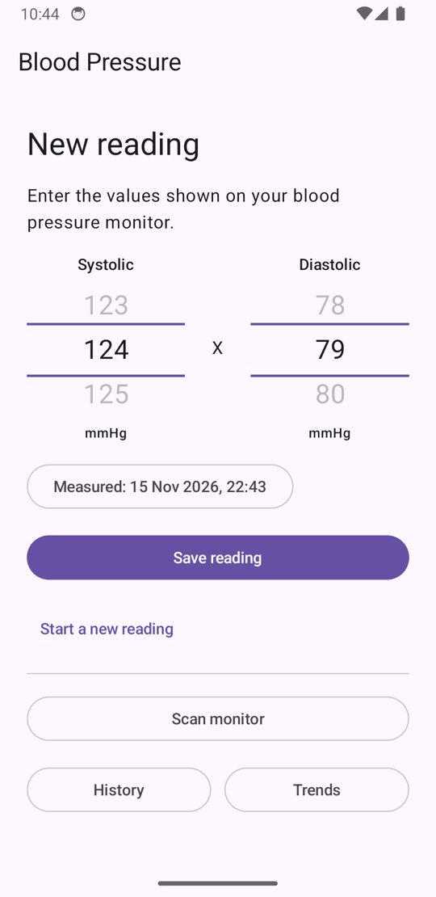
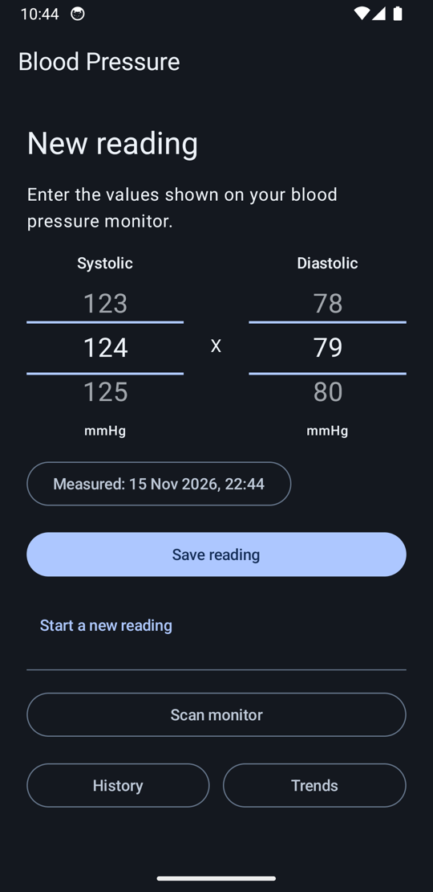
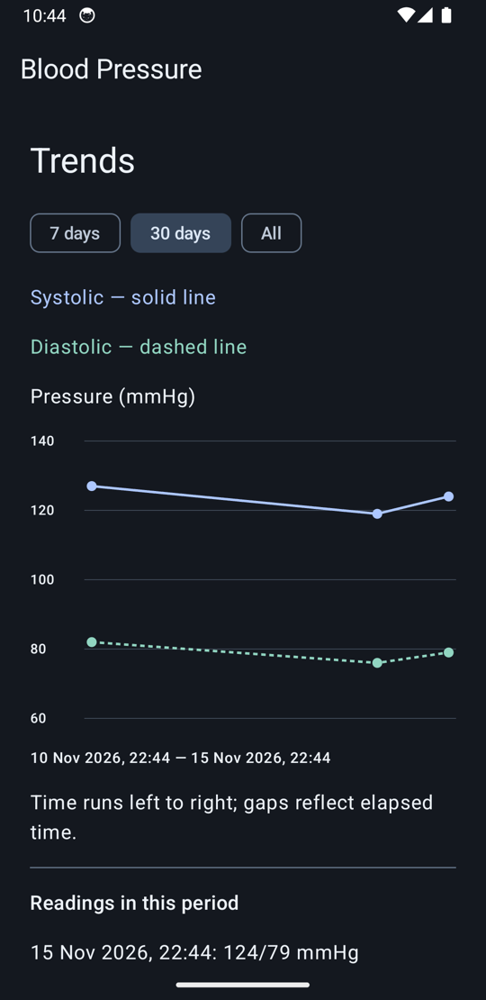
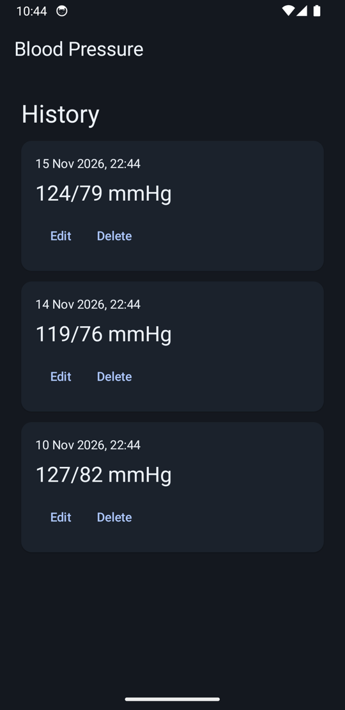
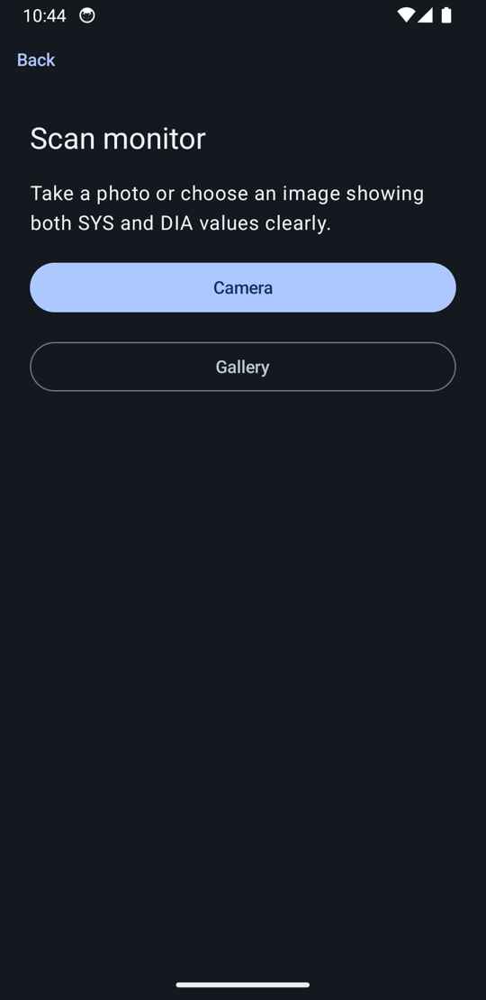
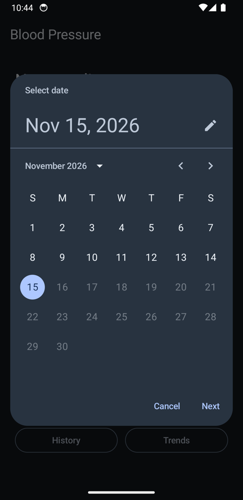

# Blood Pressure

**A simple journal for your blood-pressure readings.**

Swipe in the numbers from your monitor, scan a photo, and see how your readings change over time. Built for Android with Kotlin, Jetpack Compose, and Material 3—with a custom number wheel, readable dark mode, and optional Health Connect integration.

[See the app](#screenshots) · [Features](#features) · [Build it](#build-it) · [How scanning works](#scan-a-monitor) · [Developer notes](#developer-notes)

## Screenshots

Actual app screens captured on an Android emulator with synthetic readings. The light and dark themes use the same layouts and controls.

<table>
  <tr>
    <th>Enter a reading</th>
    <th>Dark mode</th>
    <th>See the trend</th>
  </tr>
  <tr>
    <td></td>
    <td></td>
    <td></td>
  </tr>
  <tr>
    <th>Review your history</th>
    <th>Scan a monitor</th>
    <th>Set the measurement date</th>
  </tr>
  <tr>
    <td></td>
    <td></td>
    <td></td>
  </tr>
</table>

[Capture details and reproduction](docs/screenshots/README.md)

## Features

- **Swipe to enter.** Custom Compose number wheels with snapping and faded neighboring values. Start from your latest saved reading, or **120/80** when there is no history. A loading indicator keeps temporary defaults from flashing on screen.
- **Keep the measurement time.** Choose the date and time the reading was taken. Edit an existing reading without creating another record.
- **Read your history.** Newest-first entries with edit/delete actions. Charts show systolic and diastolic readings over 7 days, 30 days, or all time, with proportional time spacing and a textual list of exact values.
- **Scan a photo.** Take a picture or choose one from your gallery. On-device recognition fills an editable draft; saving is always a separate action.
- **Choose your account.** Use Google sign-in or start as a guest. Guest accounts can be linked to Google to keep access across installations.
- **Take your data with you.** Export a CSV snapshot with units and UTC timestamps. Optionally copy saved readings to Health Connect.
- **Use either theme.** Wallpaper-derived light colors on supported Android versions, a consistent charcoal dark palette, and edge-to-edge layouts that account for system bars, cutouts, and keyboard insets.

## Scan a monitor

1. Tap **Scan monitor**, then choose **Camera** or **Gallery**.
2. Capture or select a photo showing both pressure values.
3. Wait for local recognition. The app fills the wheels and shows a short toast, or offers another image if it cannot find a plausible pair.
4. Review the suggested values and tap **Save reading**.

Recognition uses [7-segment-digits-Scanner](https://github.com/artemidius/7-segment-digits-Scanner), combining a seven-segment detector with printed-text OCR. The app ranks possible pressure pairs using their positions, sizes, labels, and neighboring fields, helping separate pressure from pulse and clock readings.

Images larger than **1280 pixels on their longest side** are resized proportionally for recognition. Smaller images keep their dimensions. Gallery originals are never modified, and temporary camera captures are cleaned up after processing.

Recognition is a best guess and can misread digits or assign the wrong fields. Results remain editable and are never saved automatically. Image processing runs on the device; the app does not upload the selected photo for recognition. ML Kit SDK diagnostics are separate from image processing.

See [scanner architecture, model setup, and limitations](docs/SCANNER.md).

## Your data

| Data | Where it goes |
| --- | --- |
| Saved readings | Cloud Firestore, scoped to the signed-in account, with a local cache and pending-write feedback |
| Selected monitor photos | Processed on-device; gallery originals stay in place |
| Camera captures | Temporary private app cache, removed after processing or cancellation |
| CSV exports | A separate file at the location you choose |
| Health Connect copies | Written only when you enable copying and grant permission |

The app has no advertising or Firebase Analytics integration. ML Kit may transmit SDK usage/performance diagnostics; the in-app privacy page describes this separately. App-storage cloud and device-transfer backups are disabled.

A guest account belongs to its installation. Link Google before signing out, reinstalling, or clearing app data if you want to retain access. Linking to an already-existing Google account does not automatically merge histories.

Health Connect copying happens when readings are saved; it does not import or backfill your history. Editing a linked reading updates its linked copy. Exports and Health Connect copies are separate from cloud account/data deletion.

## Build it

### Requirements

| Component | Requirement |
| --- | --- |
| Device | Android 10 / API 29 or newer |
| Android SDK | Compile SDK 37; target SDK 36 |
| Gradle JVM | Java 21; daemon toolchain configuration is included |
| Backend | Firebase Authentication and Cloud Firestore |
| Scanner | A compatible exported detector model, prepared locally |

The project uses the Gradle wrapper. Java/Kotlin source compatibility is set to Java 17; the Gradle daemon runs on Java 21.

### 1. Get the project

```sh
git clone https://github.com/artemidius/blood_pressure.git
cd blood_pressure
```

Open it in Android Studio and install the required SDK components.

### 2. Configure Firebase

Register an Android app with package **`com.artemidius.bloodpressure`** in your Firebase project, then use its configuration at `app/google-services.json`.

- Enable **Google** and **Anonymous** authentication.
- Register your debug/release signing certificate fingerprints for Google sign-in.
- Create a Cloud Firestore database and deploy the repository's [owner-scoped rules](firestore.rules).

The repository’s `.firebaserc` points to the original development project. When using your own backend, pass your project ID explicitly with an authenticated Firebase CLI:

```sh
firebase deploy --only firestore:rules --project YOUR_FIREBASE_PROJECT_ID
```

### 3. Prepare the scanner model

The detector weights are **not included in Git**. Prepare a compatible export containing `detector.tflite`, `detector.json`, and `MODEL_LICENSE`, then run:

```sh
python3 scripts/prepare_scanner_model.py /path/to/model-export
```

The script checks the model checksum and copies the assets into the app. Gradle verifies those assets before building. Follow [the model setup guide](docs/SCANNER.md#model-setup) for provenance and export instructions.

The scanner engine is Apache-2.0 licensed; the current SMART-BP model has a separate **AGPL-3.0** license. Model-bearing APKs include the weights, so review the retained model license and third-party notices before distribution. The engine's license does not replace the model's terms.

### 4. Build and install

```sh
./gradlew testDebugUnitTest lintDebug assembleDebug
adb install -r app/build/outputs/apk/debug/app-debug.apk
```

`install -r` updates an existing installation while retaining its app data. Release distribution requires your signing configuration.

## Developer notes

The app uses **Kotlin · Jetpack Compose · Material 3 · ViewModel/StateFlow · Hilt · Firebase · Health Connect · LiteRT/ML Kit**.

| Area | Entry point |
| --- | --- |
| Screens, navigation, and insets | [`compose/screens`](app/src/main/java/com/artemidius/bloodpressure/compose/screens) |
| Custom swipe wheels | [`compose/picker`](app/src/main/java/com/artemidius/bloodpressure/compose/picker) |
| Reading and scanning state | [`viewmodel`](app/src/main/java/com/artemidius/bloodpressure/viewmodel) |
| Photo decoding and pressure extraction | [`ml`](app/src/main/java/com/artemidius/bloodpressure/ml) |
| Storage, export, and date conversion | [`data`](app/src/main/java/com/artemidius/bloodpressure/data) |
| Health Connect | [`health/connect`](app/src/main/java/com/artemidius/bloodpressure/health/connect) |

### Run tests

JVM tests cover reading validation, CSV export, save retries, account isolation, scan state, spatial pressure extraction, time-zone conversion, and dark-theme contrast.

```sh
./gradlew testDebugUnitTest lintDebug
```

For Android tests, install both APKs and invoke instrumentation directly. This avoids the target-app uninstall that can happen with Gradle's connected-test lifecycle and preserves an existing guest session.

```sh
./gradlew assembleDebug assembleDebugAndroidTest
adb install -r app/build/outputs/apk/debug/app-debug.apk
adb install -r app/build/outputs/apk/androidTest/debug/app-debug-androidTest.apk
adb shell am instrument -w \
  com.artemidius.bloodpressure.test/androidx.test.runner.AndroidJUnitRunner
```

On a throwaway emulator, Gradle can drive the same suite itself, either on an already-running device or on a managed emulator it provisions headlessly:

```sh
./gradlew connectedDebugAndroidTest     # uses the connected device/emulator
./gradlew pixel7Api35DebugAndroidTest   # downloads and boots a managed emulator
```

Device tests exercise the actual detector on monitor photos, EXIF rotation, image-size limits, swipe controls, loading/error states, date/time dialogs, trend-period filtering, history edit/delete, account settings, and inset handling. Compose screens are tested in isolation with state and callbacks, without Firebase or an activity. See the [scanner guide](docs/SCANNER.md#verification) for the opt-in supplied-photo regression test.

Firestore rules tests use an isolated demo emulator, not live readings. They require Node 24.12+ and the Firebase CLI:

```sh
npm --prefix tools/security-tests ci
firebase emulators:exec --only firestore --project demo-blood-pressure \
  'npm --prefix tools/security-tests test'
```

### Preview without cloud data

A debug-only activity renders synthetic readings without accessing Firebase or Health Connect. It is absent from release builds.

```sh
adb shell am start -n com.artemidius.bloodpressure/.ReviewActivity --es screen home
adb shell am start -n com.artemidius.bloodpressure/.ReviewActivity --es screen graph --ez dark true
```

Available screens: `home`, `history`, `graph`, `scan`, and `loading`. Add `--ez large true` to review larger text. Close the preview activity between launches to apply different extras to a fresh instance.

### More detail

- [Scanner: model, pipeline, and regression tests](docs/SCANNER.md)
- [Dark mode: palette, contrast, and date/time dialogs](docs/DARK_MODE.md)
- [Edge-to-edge layout and inset ownership](docs/EDGE_TO_EDGE.md)
- [Reliability review and device acceptance checklist](docs/POLISH.md)
- [Screenshot provenance and capture instructions](docs/screenshots/README.md)
